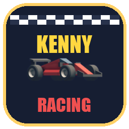

<p align="center"></p>

# Kenny Racing (Belohnungsspiel-Edition)

Dieses Rennspiel ist optimiert als motivierendes **Belohnungsspiel für Kinder-Lern-Apps** in Godot 4 (mit 4 Runden, Siegbildschirm, Touch-Steuerung, Falschfahrer-Warnung, Fahrzeugauswahl und Streckenbuilder mit Welten).

---

### 🎮 Steuerung (Controls)

| Eingabe | Aktion |
| --- | --- |
| **Touchscreen / Analogstick** | **Intuitiv:** Stick in Wunschrichtung bewegen (Auto dreht und fährt dorthin)<br>**Klassisch:** Oben = Gas, Unten = Rückwärts, Links/Rechts = Lenken |
| <kbd>W</kbd> / <kbd>↑</kbd> | Beschleunigen / Vorwärts |
| <kbd>S</kbd> / <kbd>↓</kbd> | Bremsen / Rückwärts |
| <kbd>A</kbd> <kbd>D</kbd> / <kbd>←</kbd> <kbd>→</kbd> | Lenken |
| <kbd>R</kbd> / Button "🔄 Zurücksetzen" | Auto zurücksetzen (auf Streckenmitte in Fahrtrichtung) |

---

### 🏎️ Fahrzeugauswahl (Vehicle Selection)

Im Startbildschirm kann das Fahrzeug in zwei Dimensionen gewählt werden:

1. **Grundtyp (Seitliches Scrollen / Karussell)**:
   - 🚚 **Racing Truck**: Klassischer Allround-Renn-Truck mit 4 Rädern & tollem Drift-Verhalten (`models/vehicle-truck-*.glb`).
   - 🏎️ **Rennwagen**: Flacher, aerodynamischer Formel-Flitzer aus dem *Kenney Racing-Kit* (`models/vehicle-racecar-*.glb`).
   - 🏍️ **Motorrad**: Wendiges Bike, das sich dynamisch mit Schräglage in die Kurven legt (`models/vehicle-motorcycle.glb`).

2. **Farbe (Horizontaler Scroll / Farb-Palette)**:
   - **Truck**: 🟡 Gelb, 🔴 Rot, 🟢 Grün, 🟣 Violett
   - **Rennwagen**: 🔴 Rot, 🟢 Grün, 🟠 Orange, ⚪ Weiß
   - **Motorrad**: 🔴 Renn-Rot

Das 3D-Fahrzeug aktualisiert sich sofort sichtbar in Echtzeit auf der Startlinie.

---

### 🌍 Welten & Streckenbuilder

Das Spiel und der Bausatz sind in **3 thematische Welten** unterteilt:

1. 🌲 **Wald & Natur**:
   - Grüne Rennstrecke im Wald mit Baumreihen (`treeLarge`, `treeSmall`, `decoration-forest`) und Camping-Zelten (`tent`, `decoration-tents`).
   - MeshLibrary: `models/Library/mesh-library-forest.tscn`

2. 🏟️ **Grand Prix Stadion (Neue Strecke)**:
   - Motorsport-Arena aus dem *Kenney Racing-Kit*.
   - Startaufstellungs-Grid (`roadStartPositions`), Boxengasse (`pitsGarage`, `pitsOffice`), überdachte Tribünen (`grandStandCovered`, `grandStandRound`), Überkopf-Startbrücke (`overheadRoundColored`), Flutlichtmasten (`lightPostLarge`), Sponsorenwände (`billboard`) und Zielflaggen.
   - MeshLibrary: `models/Library/mesh-library-stadium.tscn`

3. 🏜️ **Wüsten-Rallye & Sand**:
   - Staubige Rallyestrecke mit Schanzen (`ramp`), Sandkurven (`roadCornerLargeSand`), roten & weißen Aufprall-Barrieren (`barrierRed`, `barrierWhite`), Begrenzungszäunen (`fenceStraight`), Pylonen und Bannertürmen.
   - MeshLibrary: `models/Library/mesh-library-rally.tscn`

#### Verwendung des Streckenbuilders:
- **Im Spiel**: Klicke im Startbildschirm auf "**🏗️ Streckenbuilder & Bausätze ansehen**". Wähle eine Welt, blättere durch die Bauteile-Kategorien und starte mit einem Klick auf "*🏁 In dieser Welt fahren!*".
- **Im Godot-Editor**: Wähle den `GridMap`-Knoten in `scenes/main.tscn` und weise im Inspektor die gewünschte thematische MeshLibrary zu (`mesh-library-forest.tscn`, `mesh-library-stadium.tscn` oder `mesh-library-rally.tscn`), um übersichtlich und ohne Kachel-Überflutung Strecken zu bauen.

---

### 🎓 Integration in Lern-Apps (Belohnungsspiel)

- **4-Runden-Begrenzung**: Das Rennen endet automatisch nach genau 4 vollständigen Runden.
- **Falschfahrer-Meldung**: Wenn das Auto falsch herum fährt, warnt ein pulsierendes Banner `⚠️ FALSCHE RICHTUNG! ↩️ Bitte umdrehen!`.
- **Schnittstelle**:
  - GDScript Signal: `race_manager.race_reward_completed(data: Dictionary)`
  - Web/HTML5 `postMessage`:
    ```javascript
    window.addEventListener("message", (event) => {
      if (event.data && event.data.type === "KENNY_RACING_COMPLETED") {
        console.log("4 Runden geschafft in Zeit:", event.data.time);
        // Belohnung in der Lern-App gutschreiben!
      }
    });
    ```

---

### 📄 Lizenz

- Quellcode: MIT License (Kenney & Contributors)
- Assets (3D-Modelle, Sprites, Sounds): [CC0 1.0 Universal](https://creativecommons.org/publicdomain/zero/1.0/) (Kenney)
